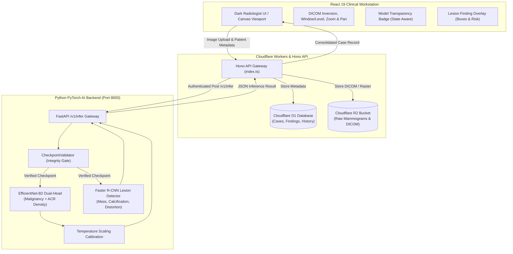

# Scanora — AI-Assisted Mammography Analysis & Clinical Workstation

[](#)
[](#)
[](#)
[](#)
[](#)

> [!WARNING]
> **RESEARCH PROTOTYPE ONLY — NOT APPROVED FOR AUTONOMOUS CLINICAL DIAGNOSIS**  
> Scanora is an investigational software prototype designed for scientific research, clinical workflow validation, and educational demonstration. It is not cleared by the US FDA, CE marked, or approved by any medical regulatory authority. It must never replace clinical judgment, certified radiologist review, or tissue biopsy. Never promise 100% diagnostic accuracy.

---

## 1. System Architecture

Scanora combines a high-performance clinical radiology web workstation with an asynchronous cloud edge API and a deep learning computer vision microservice:



---

## 2. Model Lifecycle & Safety Gates

To guarantee scientific honesty, Scanora strictly enforces a 4-tier lifecycle gatekeeper in `CheckpointValidator`:

1. **`MODEL_UNAVAILABLE` (Default State):**
   - Active when no verified trained checkpoint is loaded on disk.
   - **Safety Gate:** Untrained random linear heads are strictly prevented from executing inference. The API returns HTTP 503 (`SERVICE_UNAVAILABLE`).
   - Arbitrary or random cancer risk numbers (e.g. 50.21%) can never be emitted as clinical predictions.
2. **`SIMULATED_DEMO`:**
   - Active when demo fallback mode is explicitly enabled by the user or test runner.
   - Returned outputs bear `checkpointId: "simulation-fallback"` and bright amber visual warnings.
   - Prohibited from being represented as genuine patient findings.
3. **`RESEARCH_UNVALIDATED`:**
   - Active when task-trained mammography checkpoints (`task_trained: True`) are physically verified and loaded.
   - Investigational and research decision-support only. Not certified for autonomous triage.
4. **`VALIDATED_FOR_INTENDED_USE`:**
   - Requires verified multi-reader multi-case (MRMC) clinical trial evidence and formal regulatory authorization (e.g. FDA 510(k), CE mark).
   - **Internal benchmark evaluation or training alone can NEVER grant this status.** Any checkpoint claiming this state without authorization is automatically downgraded to `RESEARCH_UNVALIDATED`.

---

## 3. Installation & Run Instructions

### Prerequisites
- Node.js 20+ and npm
- Python 3.12+ (or uv package manager)
- Git

### A. Frontend & Cloudflare Worker (Node.js)

```powershell
# 1. Install dependencies
npm.cmd install

# 2. Run unit & clinical schema validation tests
npm.cmd test

# 3. Run ESLint code quality checks
npm.cmd run lint

# 4. Compile and verify production build
npm.cmd run build

# 5. Start the local development server (Workstation UI & Worker API)
npm.cmd run dev
```

The workstation will be available at `http://localhost:5173`.

### B. Python AI Inference Microservice (PyTorch)

```powershell
# 1. Create and activate a Python 3.12 virtual environment
python -m venv ai_service\.venv
& "ai_service\.venv\Scripts\Activate.ps1"

# 2. Install PyTorch and computer vision dependencies
pip install -r ai_service\requirements.txt

# 3. Run the complete automated Python test suite (21 tests)
$env:PYTHONPATH="."; & "ai_service\.venv\Scripts\python.exe" -m pytest ai_service/tests

# 4. Launch the AI inference service on localhost:8000
$env:PYTHONPATH="."; & "ai_service\.venv\Scripts\python.exe" -m uvicorn ai_service.main:app --host 127.0.0.1 --port 8000
```

The AI service health status can be queried at:
```powershell
curl http://127.0.0.1:8000/health
curl http://127.0.0.1:8000/v1/model-info
```

---

## 4. Dataset Acquisition & Supervised Training Runbook

Legitimate training requires credentialed, patient-consented medical imaging datasets:

### Datasets Required
1. **VinDr-Mammo (FFDM):** 5,000 screening exams, 20,000 digital mammograms with expert BI-RADS and bounding box annotations.
   - Acquire via PhysioNet Credentialed Data Use Agreement: https://physionet.org/content/vindr-mammo/
2. **CBIS-DDSM:** 2,620 scanned film mammograms with biopsy-proven ground truth.
   - Acquire via The Cancer Imaging Archive: https://www.cancerimagingarchive.net/collection/cbis-ddsm/

### Splitting Protocol (Zero Leakage)
- **70% Training / 15% Validation / 15% Independent Test.**
- Splitting is performed strictly at the **patient ID** level (`patient_id`). All views (L-CC, L-MLO, R-CC, R-MLO) for any given patient reside in the same split to prevent intra-patient data leakage.
- Seed is locked deterministically (`seed=42`).

### Running Training & Independent Evaluation
```powershell
# Run supervised multi-task training with deterministic seeds
$env:PYTHONPATH="."; & "ai_service\.venv\Scripts\python.exe" -m ai_service.training.train

# Run independent evaluation on held-out patient-level test set
$env:PYTHONPATH="."; & "ai_service\.venv\Scripts\python.exe" -m ai_service.training.evaluate
```

---

## 5. Verification Test Suite Matrix

The project features automated regression tests verifying all 12 Phase 2 test conditions:

| ID | Test Scenario | Location | Result |
|---|---|---|---|
| T1 | Missing classifier checkpoint blocks inference with HTTP 503 `MODEL_UNAVAILABLE` | `ai_service/tests/test_ai_pipeline.py` | **PASS** |
| T2 | Untrained linear head forward pass blocked from emitting cancer probability | `ai_service/tests/test_ai_pipeline.py` | **PASS** |
| T3 | Missing detector checkpoint returns `detector_status: "UNAVAILABLE"` with 0 findings | `ai_service/tests/test_ai_pipeline.py` | **PASS** |
| T4 | Corrupted or truncated checkpoint (< 1KB) safely rejected | `ai_service/tests/test_ai_pipeline.py` | **PASS** |
| T5 | Incompatible architecture weights (missing heads) safely rejected | `ai_service/tests/test_ai_pipeline.py` | **PASS** |
| T6 | Unauthorized claim of `VALIDATED_FOR_INTENDED_USE` downgraded to `RESEARCH_UNVALIDATED` | `ai_service/tests/test_ai_pipeline.py` | **PASS** |
| T7 | Valid research checkpoint loads and executes calibrated prediction | `ai_service/tests/test_ai_pipeline.py` | **PASS** |
| T8 | Full-Field preprocessing produces 1×1×512×512 tensors and maps coordinates | `ai_service/tests/test_ai_pipeline.py` | **PASS** |
| T9 | Unauthorized requests without Bearer token rejected with HTTP 401 | `ai_service/tests/test_ai_pipeline.py` | **PASS** |
| T10 | Malformed image payload rejected with HTTP 400 | `ai_service/tests/test_ai_pipeline.py` | **PASS** |
| T11 | FNR, 95% Bootstrap CI, density breakdown, and patient max-pooling evaluation | `ai_service/tests/test_ai_pipeline.py` | **PASS** |
| T12 | Zod Schema enforcement for BI-RADS, Density, Findings, and Lifecycle statuses | `test/clinical-engine.test.js` | **PASS** |

---

## 6. Regulatory & Clinical Disclaimer

Scanora is an investigational software prototype. It is not a medical device. It has not been approved or evaluated by the FDA or any competent regulatory health authority. Outputs generated by the machine learning models are for investigational use only and must not be used for patient diagnosis or treatment selection without direct, independent clinical verification.
